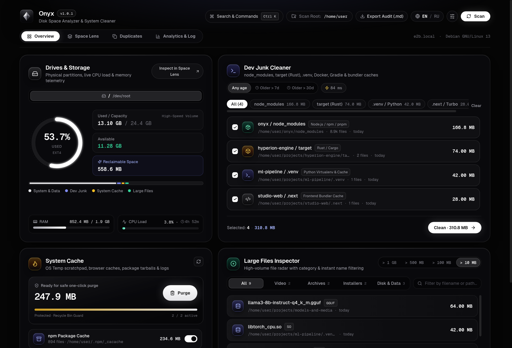
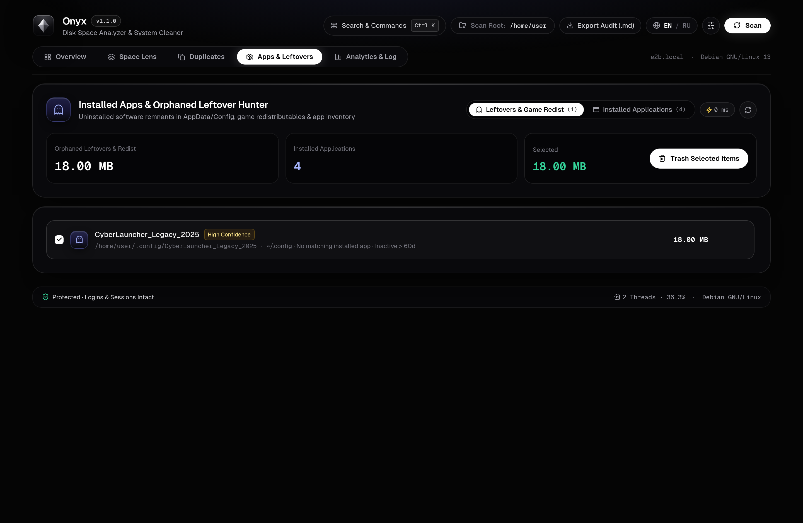
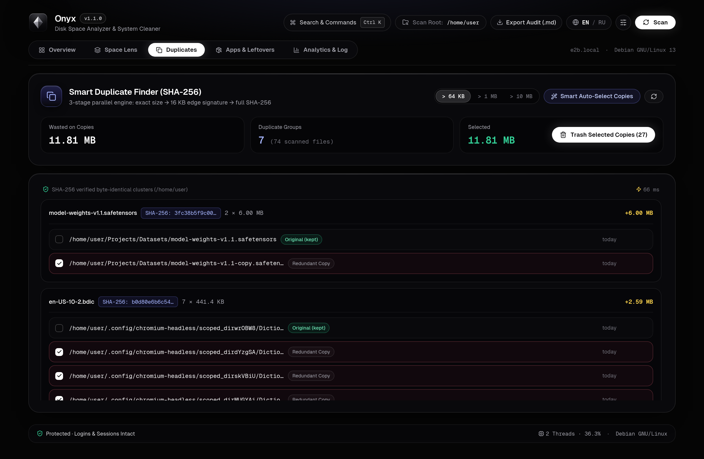

<div align="center">
  

  # Onyx

  **High-Performance Desktop Disk Space Analyzer & System Cleaner**  
  *Native Multi-Threaded Rust Engine & Obsidian Bento UI for Windows, Linux & macOS*

  [](https://github.com/ThatPawsAtYou/onyx/releases/latest)
  [](https://v2.tauri.app/)
  [](https://www.rust-lang.org/)
  [](https://react.dev/)
  [](#downloads--releases)
  [](./LICENSE)
</div>

---

<div align="center">
  
</div>

---

## Screenshots

| Space Lens — Treemap & Storage Diff | Installed Apps & Orphaned Leftover Hunter |
| :---: | :---: |
|  |  |
| **Smart Duplicate Finder (`SHA-256`)** | **Analytics & Cleanup Audit Log** |
|  |  |
| **Command Palette (`Ctrl+K` / `⌘K`)** | **Built-In Russian (`RU`) Localization** |
|  |  |

---

## Overview

**Onyx** is a fast, native, cross-platform desktop utility for analyzing disk usage, tracking folder growth over time, hunting orphaned application leftovers, and safely reclaiming gigabytes of wasted storage. Engineered at the intersection of systems-level **Rust** performance and modern **Framer / Linear / Raycast** dark-mode craft, Onyx replaces cluttered legacy file tables with an interactive **Bento Grid** canvas (`#050505`), tactile spring animations, and work-stealing parallel filesystem traversal (`jwalk` + `rayon` + `walkdir` + `sha2`).

Onyx runs **100% locally** against real operating system telemetry with zero external network calls, zero ads, and strict OS Recycle Bin / Trash + Protected Whitelist guardrails. Out of the box, the interface defaults to **English (`EN`)** and includes a one-click in-app language toggle for **Russian (`RU`)**.

---

## What's New in `v1.1.0`

1. **Storage Snapshots & Diff Mode ("Where Did My Space Go?"):** Space Lens automatically captures lightweight local directory snapshots and highlights exact folder growth (`+28.0 MB` in rose) or shrinkage (`-1.4 GB` in emerald) since your last baseline, complete with **`Changed Only`** filtering and **`Update Snapshot`** controls.
2. **Gaming, GPU Shader & Messenger Cache Cleaner:** Safe, session-preserving cache cleanup for **DirectX (`D3DSCache`)**, **NVIDIA (`DXCache`/`GLCache`)**, **AMD (`DxCache`)**, **Mesa**, **Steam (`depotcache`/`shadercache`)**, **Epic Games**, **Battle.net**, **EA**, **Riot**, **Telegram Desktop** media caches, **Discord**, **Slack**, **Spotify**, **VS Code**, **Figma**, and **Adobe Media Cache** — without ever touching logins, sessions, or game saves.
3. **Installed Apps & Orphaned Leftover Hunter (`Apps & Leftovers`):** Lists installed applications (`HKCU`/`HKLM` Windows Registry or Linux `.desktop`/Flatpak/Snap), detects orphaned `AppData`/`~/.config` folders left behind by uninstalled software, surfaces duplicate **`_CommonRedist`** game installers (`DirectX` / `VC++`), and launches native uninstallers directly.
4. **Protected Paths Whitelist & `.onyxignore`:** Pin any folder or file to your Protected Whitelist (via the Shield icon, Right-Click menu, or Settings) or drop a `.onyxignore` file into any project root — Onyx will never select or recycle protected paths.
5. **Windows Explorer `"Inspect in Onyx"`, Drag & Drop, Right-Click Menu & Live Stop:**
   - One-click **`"Inspect in Onyx"`** Windows Explorer folder context menu toggle (`HKCU`, zero admin/UAC required).
   - **Drag & Drop** any folder onto the Onyx window to inspect it immediately in Space Lens.
   - Custom in-app **Right-Click Context Menu** (*Inspect in Space Lens*, *Reveal in Explorer*, *Copy Full Path*, *Protect Path*, *Move to Recycle Bin*).
   - **Live Cancellable Scan Progress Bar** with real-time file/byte counters and instant **`Stop`** cancellation.
6. **WSL2 & Docker Virtual Disk (`.vhdx`) Detector:** Automatically flags bloated `ext4.vhdx` / Docker virtual disks in Large Files, prevents accidental deletion of your Linux/container filesystem, and provides a one-click **`Copy Shrink Cmd`** button (`wsl --shutdown ; Optimize-VHD ...`) to compact reclaimed space safely.

---

## Core Capabilities

### 1. Modular Bento Overview Dashboard
- **Drives & Storage (`StorageGaugeCard`):** Orbital circular capacity gauge, instant partition switcher (`C:\`, `D:\`, `/`, removable NVMe/USB drives), multi-segment usage breakdown bar, and live **RAM**, **CPU load**, and **OS uptime** telemetry.
- **Dev & Game Junk Cleaner (`DevJunkCard`):** Parallel scanner targeting heavy build and game redistributable artifacts:
  - `node_modules` (Node.js / npm / pnpm / Bun)
  - `target` (Rust / Cargo — validated against `Cargo.toml`)
  - `.venv`, `venv`, `__pycache__`, `.pytest_cache`, `.ruff_cache` (Python)
  - `Docker` build caches, `.gradle`, `Pods` (CocoaPods), `DerivedData`, `.next`, `.turbo`
  - `_CommonRedist` / `Redist` (Steam / Epic duplicate DirectX & VC++ installers)
  - Includes a **Smart Project Age Filter** (*Any age*, *Older > 7d*, *Older > 30d*) and `.onyxignore` support.
- **System, Gaming & GPU Cache (`SystemCacheCard`):** Category filter tabs (*All*, *GPU & Gaming*, *Apps & Chat*, *Browsers & OS*), granular `Radix Switch` toggles, and an animated **Purge** module tracking reclaimed gigabytes.
- **Large Files & Virtual Disks (`LargeFilesCard`):** High-volume file radar (`> 1 GB`, `> 500 MB`, `> 100 MB`, `> 10 MB`) with `useDeferredValue` instant search and WSL2/Docker `.vhdx` compaction guidance.

### 2. Space Lens — Interactive Directory Treemap & Storage Diff
- Visual proportional folder footprint map inspired by WizTree and DaisyDisk, enhanced with **Storage Diff** delta tracking (`+Δ` / `-Δ` bytes since last snapshot).
- Click any folder tile to drill deeper, right-click for quick actions, protect sensitive directories with one click, or switch across physical drives (`C:\`, `D:\`, `/`).

### 3. Smart Duplicate Finder (`SHA-256`)
- Three-stage parallel cryptographic pipeline (`jwalk` + `rayon` + `sha2`) using 128 KB stack buffers:
  1. Exact byte-size clustering (skipping NTFS junctions and unpinned OneDrive/iCloud cloud-only stubs).
  2. Fast 16 KB edge signature pre-hash (first 8 KB + last 8 KB).
  3. Full **SHA-256** verification to guarantee zero false positives.

### 4. Installed Apps & Orphaned Leftover Hunter
- Inspects installed desktop software, highlights orphaned `AppData` / `~/.config` remnants from uninstalled applications with confidence scoring, and routes selected leftovers safely to the OS Recycle Bin.

### 5. Analytics, Cleanup Audit Log & Native Report Export
- **File Extensions Footprint:** Zero-allocation extension aggregator ranking disk usage across `.vhdx`, `.mp4`, `.rlib`, `.so`, `.zip`, `.gguf`, `.exe`, and more.
- **Persistent Cleanup Audit Log & Export:** Records every cleanup batch (`cleanup_history.json`) and exports full **Markdown (`.md`)** or **JSON (`.json`)** audit reports directly to `Downloads`.

---

## Safety Architecture (`safety.rs` + `whitelist.rs`)

Onyx is engineered around **Zero Destructive Surprise**:
1. **Kernel & System Path Guardrails:** Normalizes Windows verbatim prefixes (`\\?\`) and blocks deletion of filesystem roots (`C:\`, `D:\`, `/`), user home roots, and critical OS directories (`C:\Windows`, `C:\Program Files`, `C:\ProgramData`, `C:\Recovery`, `$Recycle.Bin`, `/usr`, `/etc`, `/bin`, `/boot`, `/proc`, `/sys`, `/dev`, `/System`).
2. **User Protected Whitelist & `.onyxignore`:** User-pinned paths (`protected_paths.json`) and directories containing `.onyxignore` are enforced in both the UI and the Rust deletion engine (`cleaner.rs`).
3. **OS Recycle Bin First:** Deletions route through the native OS Recycle Bin (COM `IFileOperation` + `SHFileOperationW` with `FOF_ALLOWUNDO` on Windows; `trash` crate on Linux/macOS).
4. **Virtual Disk & Session Safety:** Messenger cleaners target media/GPU cache subdirectories only (never session tokens or saved games), and `.vhdx` virtual disks offer non-destructive compaction commands instead of trash buttons.

---

## Downloads & Releases

Download pre-built **`v1.1.0`** native binaries for **Windows (x64)** and **Linux (x86_64)** from [**GitHub Releases (`v1.1.0`)**](https://github.com/ThatPawsAtYou/onyx/releases/latest) or directly from [`./releases/`](./releases/):

| Platform | Artifact | Format | Description |
| :--- | :--- | :--- | :--- |
| **Windows 10/11 (x64)** | [`Onyx_1.1.0_x64-setup.exe`](https://github.com/ThatPawsAtYou/onyx/releases/latest) | NSIS Installer (`.exe`) | Native desktop installer with Start Menu / Desktop shortcuts & uninstaller |
| **Windows 10/11 (x64)** | [`onyx.exe`](https://github.com/ThatPawsAtYou/onyx/releases/latest) | Portable Native GUI (`.exe`) | Standalone single-file native Win32 + WebView2 desktop executable |
| **Linux (Debian / Ubuntu)** | [`Onyx_1.1.0_amd64.deb`](https://github.com/ThatPawsAtYou/onyx/releases/latest) | Debian Package (`.deb`) | Install via `sudo apt install ./Onyx_1.1.0_amd64.deb` |
| **Linux (x86_64)** | [`onyx-linux-x86_64`](https://github.com/ThatPawsAtYou/onyx/releases/latest) | Native ELF Binary | Direct execution: `chmod +x onyx-linux-x86_64 && ./onyx-linux-x86_64` |

SHA-256 checksums for all binaries are published in [`releases/SHA256SUMS.txt`](./releases/SHA256SUMS.txt).

---

## Building from Source

```bash
# 1. Clone the repository & install frontend dependencies
git clone https://github.com/ThatPawsAtYou/onyx.git
cd onyx
npm install

# 2. Launch native Tauri v2 desktop window in development mode
npm run tauri:dev

# 3. Build optimized native installers for your OS
npm run tauri:build

# 4. Run Rust safety, Storage Diff snapshot & Whitelist unit tests
cargo test --manifest-path src-tauri/Cargo.toml --lib
```

---

## Project Structure

```text
onyx/
├── .github/
│   ├── ISSUE_TEMPLATE/            # Bug report & feature request templates
│   ├── PULL_REQUEST_TEMPLATE.md   # PR verification checklist
│   └── workflows/
│       ├── ci.yml                 # Continuous Integration (TS build + Rust tests)
│       └── release.yml            # Multi-OS Tauri v2 release matrix (Win/Linux/macOS)
├── docs/
│   ├── onyx-dashboard.png         # Main Hero UI screenshot (v1.1.0)
│   ├── social-preview.png         # 1280x640 GitHub Social Preview banner (v1.1.0)
│   └── screenshots/               # Full Retina feature gallery (01–07)
├── public/
│   └── onyx-icon.svg              # Official Onyx crystal squircle icon
├── releases/                      # Pre-built Windows (.exe) & Linux (.deb) binaries
├── src/                           # React 18 + TypeScript + Tailwind + Framer Motion
│   ├── components/
│   │   ├── OnyxBrandIcon.tsx      # Official faceted Onyx crystal app icon
│   │   ├── BentoCard.tsx          # Memoized spotlight-tracked Bento surface
│   │   ├── ContextMenu.tsx        # Custom Obsidian right-click context menu
│   │   ├── ScanProgressBar.tsx    # Live cancellable scan progress bar
│   │   ├── StorageGaugeCard.tsx   # Drives, partitions, RAM, CPU & Space Lens link
│   │   ├── DevJunkCard.tsx        # Dev & Game Redist cleaner + age filter
│   │   ├── SystemCacheCard.tsx    # OS, GPU shader & Messenger cache cleaner
│   │   ├── LargeFilesCard.tsx     # Large file inspector + WSL2 VHDX detector
│   │   ├── SpaceLensView.tsx      # Interactive treemap + Storage Diff snapshots
│   │   ├── DuplicatesView.tsx     # 3-stage SHA-256 duplicate finder
│   │   ├── AppsAndLeftoversView.tsx # Installed apps & orphaned leftover hunter
│   │   ├── AnalyticsAndHistoryView.tsx # File extensions chart, audit log & export
│   │   ├── CommandPaletteModal.tsx     # Ctrl+K / ⌘K quick command launcher
│   │   └── SettingsAndFolderModal.tsx  # Explorer integration, Whitelist & scan root
│   ├── lib/
│   │   ├── bridge.ts              # 25-command Tauri v2 IPC / native Rust RPC bridge
│   │   ├── format.ts              # Byte & uptime formatting helpers
│   │   └── i18n.ts                # Complete English (default) & Russian dictionaries
│   ├── types/onyx.ts              # Strict Rust <-> TypeScript data contracts
│   └── App.tsx
└── src-tauri/                     # Rust + Tauri v2 native backend
    ├── capabilities/default.json  # Tauri v2 security capability permissions
    ├── icons/                     # Multi-platform icons (.ico, .icns, .png)
    ├── src/
    │   ├── main.rs                # Native entry point (windows_subsystem = "windows")
    │   ├── lib.rs                 # 25 async #[tauri::command] handlers
    │   ├── models.rs              # Serializable telemetry, diff & app structs
    │   ├── progress.rs            # Lock-free AtomicU64/AtomicBool scan cancellation
    │   ├── whitelist.rs           # Protected paths whitelist & .onyxignore engine
    │   ├── snapshots.rs           # Storage Diff baseline persistence & delta math
    │   ├── apps.rs                # Registry/Desktop app inventory, leftovers & Explorer menu
    │   ├── safety.rs              # Verbatim path normalizer + system path guards
    │   ├── scanner.rs             # Parallel disk, dev/game, GPU/app cache & VHDX engine
    │   ├── spacelens.rs           # Rayon work-stealing folder profiler & extension stats
    │   ├── duplicates.rs          # 3-stage parallel SHA-256 duplicate detector
    │   ├── history.rs             # Persistent JSON cleanup history log
    │   └── cleaner.rs             # Dual-engine Recycle Bin / Trash & Explorer reveal
    ├── Cargo.toml
    └── tauri.conf.json
```

---

## License

Released under the [MIT License](./LICENSE).
