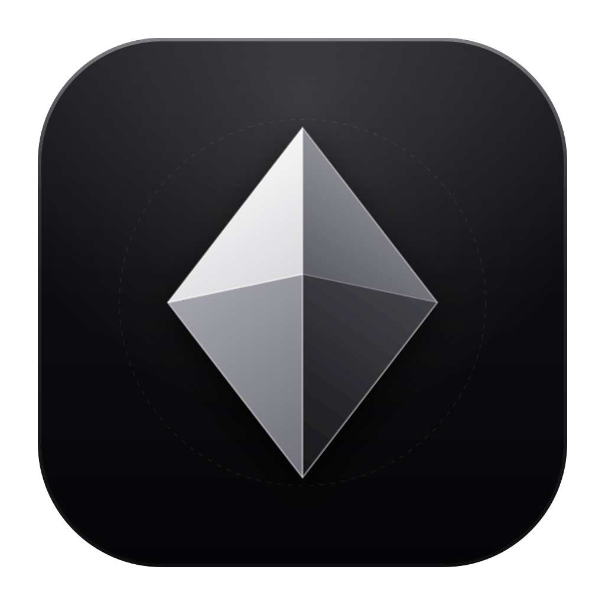
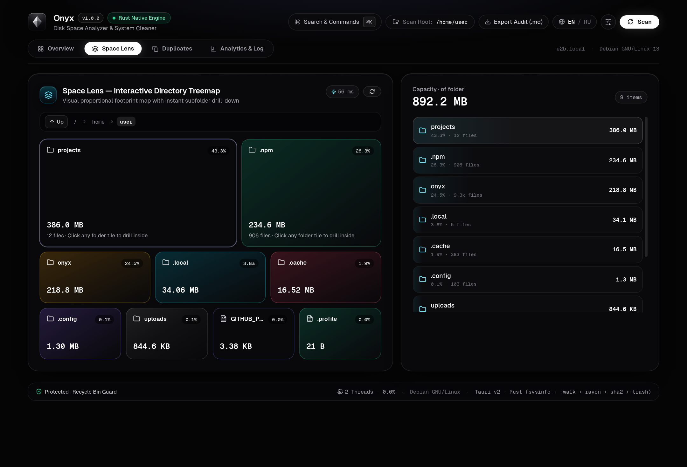
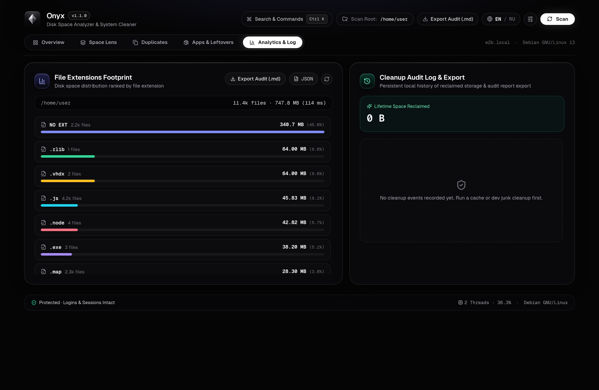
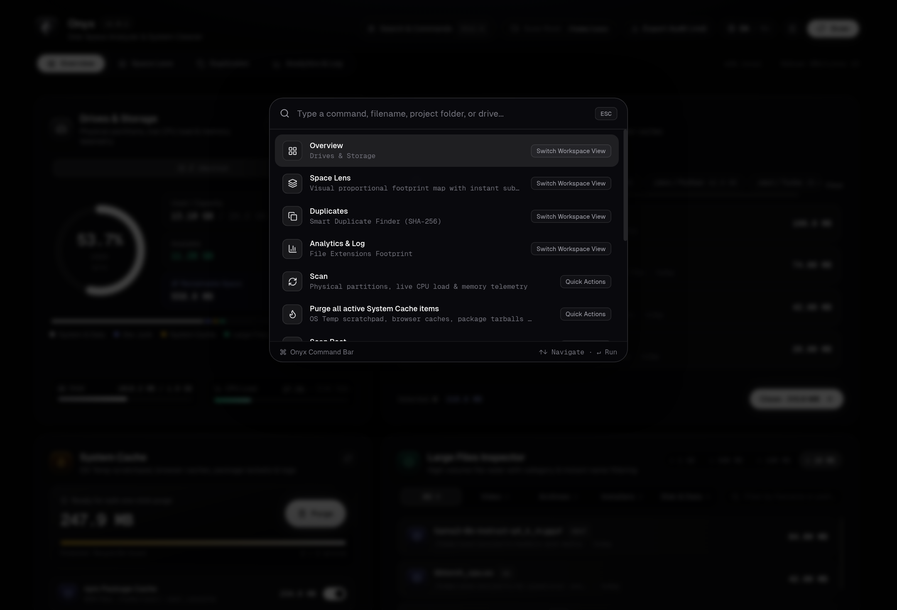
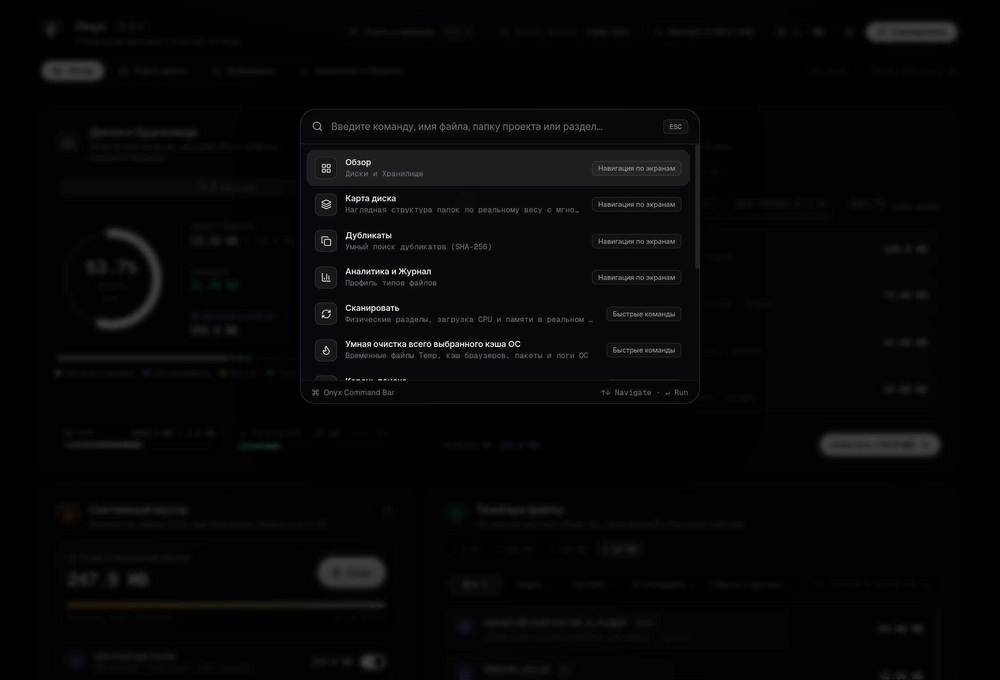

<div align="center">
  

  # Onyx

  **High-Performance Desktop Disk Space Analyzer & System Cleaner**  
  *Native Multi-Threaded Rust Engine & Obsidian Bento UI for Windows, Linux & macOS*

  [](https://github.com/ThatPawsAtYou/onyx/releases/latest)
  [](https://v2.tauri.app/)
  [](https://www.rust-lang.org/)
  [](https://react.dev/)
  [](#downloads--releases)
  [](./LICENSE)
</div>

---

<div align="center">
  
</div>

---

## Screenshots

| Space Lens — Directory Treemap | Smart Duplicate Finder (`SHA-256`) |
| :---: | :---: |
|  |  |
| **Analytics & Cleanup Audit Log** | **Command Palette (`Ctrl+K` / `⌘K`)** |
|  |  |

<details>
  <summary><strong>View Built-In Russian (RU) Localization Screenshot</strong></summary>
  <br />
  
</details>

---

## Overview

**Onyx** is a fast, native, cross-platform desktop utility for analyzing disk usage and safely reclaiming gigabytes of wasted storage. Engineered at the intersection of systems-level **Rust** performance and modern **Framer / Linear / Raycast** dark-mode craft, Onyx replaces cluttered legacy file tables with an interactive **Bento Grid** canvas (`#050505`), tactile spring animations, and work-stealing parallel filesystem traversal (`jwalk` + `rayon` + `sha2`).

Onyx runs **100% locally** against real operating system telemetry with zero external network calls, zero ads, and strict OS Recycle Bin / Trash safety guardrails. Out of the box, the interface defaults to **English (`EN`)** and includes a one-click in-app language toggle for **Russian (`RU`)**.

---

## Key Features (`v1.0.1`)

### 1. Modular Bento Overview Dashboard
- **Drives & Storage (`StorageGaugeCard`):** Orbital circular capacity gauge, instant partition switcher (`C:\`, `D:\`, `/`, removable NVMe/USB drives), multi-segment usage breakdown bar, and live **RAM**, **CPU load**, and **OS uptime** telemetry.
- **Dev Junk Cleaner (`DevJunkCard`):** Parallel scanner targeting heavy build and dependency artifacts:
  - `node_modules` (Node.js / npm / pnpm / Bun)
  - `target` (Rust / Cargo — validated against `Cargo.toml` to prevent false positives)
  - `.venv`, `venv`, `__pycache__`, `.pytest_cache`, `.ruff_cache` (Python)
  - `Docker` build caches, `.gradle`, `Pods` (CocoaPods), `DerivedData`, `.next`, `.turbo`
  - Includes a **Smart Project Age Filter** (*Any age*, *Older > 7d*, *Older > 30d*) so active projects stay untouched.
- **System Cache (`SystemCacheCard`):** Detects OS `Temp` directories, browser caches (Chrome, Edge, Brave, Firefox, Chromium), package tarballs (`npm`, `pip`, `cargo`), and crash logs with granular `Radix Switch` toggles and an animated **Purge** module tracking reclaimed gigabytes.
- **Large Files Inspector (`LargeFilesCard`):** High-volume file radar (`> 1 GB`, `> 500 MB`, `> 100 MB`, `> 10 MB`) with smooth category tabs (*Video*, *Archives*, *Installers*, *Disk & Data*) and instant filename/path search.

### 2. Space Lens — Interactive Directory Treemap
- Visual proportional folder footprint map inspired by WizTree and DaisyDisk.
- Click any folder tile to drill deeper into subdirectories, switch across physical drives (`C:\`, `D:\`, `/`), navigate back via interactive breadcrumbs, reveal paths in Windows Explorer / Finder / File Manager, or move items directly to the Recycle Bin.

### 3. Smart Duplicate Finder (`SHA-256`)
- Three-stage parallel cryptographic pipeline (`jwalk` + `rayon` + `sha2`):
  1. Exact byte-size clustering (automatically skipping NTFS junctions and unpinned OneDrive/iCloud cloud-only stubs).
  2. Fast 16 KB edge signature pre-hash (first 8 KB + last 8 KB).
  3. Full **SHA-256** verification to guarantee zero false positives.
- **Smart Auto-Select Copies** marks redundant duplicates in one click while keeping original files protected.

### 4. File Extension Analytics, Cleanup Audit Log & Native Report Export
- **File Extensions Footprint:** Ranks disk consumption across file extensions (`.so`, `.mp4`, `.zip`, `.rlib`, `.gguf`, `.exe`, `.vhdx`, etc.).
- **Persistent Cleanup Audit Log:** Locally records every cleanup batch (`cleanup_history.json`) and tracks lifetime storage reclaimed.
- **One-Click Storage Audit Export:** Saves a comprehensive system & storage report in **Markdown (`.md`)** or **JSON (`.json`)** directly to your `Downloads` folder.

### 5. Command Palette (`Ctrl+K` / `⌘K`)
- Raycast-style keyboard command launcher (`↑` `↓` `Enter` `Esc`) to jump across views, trigger scans, purge caches, export reports, or locate discovered projects and large files instantaneously.

---

## Tech Stack

### Native Shell & Backend (`src-tauri/`)
- **[Tauri v2](https://v2.tauri.app/) & Win32 WebView2** — lightweight native OS windowing (`HWND` + Microsoft Edge WebView2 on Windows, WebKitGTK on Linux, WKWebView on macOS).
- **Rust (2021 Edition)** — memory-safe systems performance with zero GC pauses.
- **`sysinfo`** — physical disk partitions, filesystems, stateful CPU delta telemetry, uptime, Swap, and RAM metrics.
- **`jwalk` + `rayon` + `walkdir`** — multi-threaded directory walking and deadlock-free parallel directory sizing across all CPU cores.
- **`sha2`** — 64 KB buffered cryptographic SHA-256 hashing for duplicate verification.
- **Win32 COM `IFileOperation` / `SHFileOperationW` & `trash`** — safe native OS Recycle Bin / Freedesktop Trash routing with extended-path (`\\?\`) normalization.

### Frontend (`src/`)
- **React 18 + TypeScript + Vite 6**
- **Tailwind CSS** — custom Obsidian Dark design tokens (`#050505`, `border-white/10`, subtle specular rims).
- **Framer Motion** — tactile spring physics (`scale: 0.98`), layout transitions, and cursor-tracked radial Bento spotlights.
- **Radix UI (`Dialog`, `Switch`, `Tooltip`)** — accessible WAI-ARIA primitives.
- **Lucide Icons + Bundled Geist Sans / Geist Mono / Inter** — 100% offline typography with `tabular-nums` precision.

---

## Safety Architecture (`safety.rs`)

Onyx is engineered around **Zero Destructive Surprise**:
1. **Kernel & System Path Guardrails:** `src-tauri/src/safety.rs` normalizes Windows verbatim prefixes (`\\?\`) and strictly blocks deletion of filesystem roots (`C:\`, `D:\`, `/`), user home roots, and critical OS directories (`C:\Windows`, `C:\Program Files`, `C:\ProgramData`, `C:\Recovery`, `$Recycle.Bin`, `/usr`, `/etc`, `/bin`, `/boot`, `/proc`, `/sys`, `/dev`, `/System`), while rejecting `..` path-traversal segments.
2. **OS Recycle Bin First:** Deletions route through the native OS Recycle Bin (COM `IFileOperation` + `SHFileOperationW` with `FOF_ALLOWUNDO` on Windows; `trash` crate on Linux/macOS) so files remain restorable.
3. **NTFS Junction & Cloud Placeholder Safety:** Skips NTFS reparse points to prevent symlink loop traversal and skips unpinned OneDrive cloud placeholders during hashing so cloud files are never downloaded unintentionally.
4. **Zero Telemetry:** Onyx makes zero outbound network connections.

---

## Downloads & Releases

Download pre-built **`v1.0.1`** native binaries for **Windows (x64)** and **Linux (x86_64)** from [**GitHub Releases (`v1.0.1`)**](https://github.com/ThatPawsAtYou/onyx/releases/latest) or directly from [`./releases/`](./releases/):

| Platform | Artifact | Format | Description |
| :--- | :--- | :--- | :--- |
| **Windows 10/11 (x64)** | [`Onyx_1.0.1_x64-setup.exe`](https://github.com/ThatPawsAtYou/onyx/releases/latest) | NSIS Installer (`.exe`) | Native desktop installer with Start Menu / Desktop shortcuts & uninstaller |
| **Windows 10/11 (x64)** | [`onyx.exe`](https://github.com/ThatPawsAtYou/onyx/releases/latest) | Portable Native GUI (`.exe`) | Standalone single-file native Win32 + WebView2 desktop executable |
| **Linux (Debian / Ubuntu)** | [`Onyx_1.0.1_amd64.deb`](https://github.com/ThatPawsAtYou/onyx/releases/latest) | Debian Package (`.deb`) | Install via `sudo apt install ./Onyx_1.0.1_amd64.deb` |
| **Linux (x86_64)** | [`onyx-linux-x86_64`](https://github.com/ThatPawsAtYou/onyx/releases/latest) | Native ELF Binary | Direct execution: `chmod +x onyx-linux-x86_64 && ./onyx-linux-x86_64` |

SHA-256 checksums for all binaries are published in [`releases/SHA256SUMS.txt`](./releases/SHA256SUMS.txt).

---

## Building from Source

### Prerequisites
- **Node.js** `>= 20.x` & `npm`
- **Rust** `>= 1.77` (`rustup`)
- Platform dependencies for Tauri v2:
  - **Windows 10/11:** Microsoft Visual Studio C++ Build Tools & WebView2 Runtime (pre-installed on Windows 10/11).
  - **Linux (Debian / Ubuntu):**
    ```bash
    sudo apt update
    sudo apt install -y libwebkit2gtk-4.1-dev build-essential curl wget file \
      libxdo-dev libssl-dev libayatana-appindicator3-dev librsvg2-dev patchelf
    ```
  - **macOS:** Xcode Command Line Tools (`xcode-select --install`).

### Development & Production Build
```bash
# 1. Clone the repository & install frontend dependencies
git clone https://github.com/ThatPawsAtYou/onyx.git
cd onyx
npm install

# 2. Launch native Tauri v2 desktop window in development mode
npm run tauri:dev

# 3. Build optimized native installers for your OS
npm run tauri:build

# 4. Run Rust safety & path normalization unit tests
cargo test --manifest-path src-tauri/Cargo.toml --lib
```

---

## Localization (`EN` / `RU`)

Onyx launches in **English (`EN`)** by default. You can switch the entire interface to **Russian (`RU`)** at any time via:
- The **`EN / RU`** pill in the top application toolbar, or
- **Settings (`⚙`) → Interface Language (`English` / `Русский`)**.

Your language preference is saved automatically across sessions.

---

## Project Structure

```text
onyx/
├── .github/
│   ├── ISSUE_TEMPLATE/            # Bug report & feature request templates
│   ├── PULL_REQUEST_TEMPLATE.md   # PR verification checklist
│   └── workflows/
│       ├── ci.yml                 # Continuous Integration (TS build + Rust tests)
│       └── release.yml            # Multi-OS Tauri v2 release matrix (Win/Linux/macOS)
├── docs/
│   ├── onyx-dashboard.png         # Main Hero UI screenshot (v1.0.1)
│   ├── social-preview.png         # 1280x640 GitHub Social Preview banner (v1.0.1)
│   └── screenshots/               # Full Retina feature gallery (01–06)
├── public/
│   └── onyx-icon.svg              # Official Onyx crystal squircle icon
├── releases/                      # Pre-built Windows (.exe) & Linux (.deb) binaries
├── src/                           # React 18 + TypeScript + Tailwind + Framer Motion
│   ├── components/
│   │   ├── OnyxBrandIcon.tsx      # Official faceted Onyx crystal app icon
│   │   ├── BentoCard.tsx          # Spotlight-tracked obsidian Bento surface
│   │   ├── StorageGaugeCard.tsx   # Drives, partitions, RAM, CPU & Space Lens link
│   │   ├── DevJunkCard.tsx        # Build artifact cleaner + stale project filter
│   │   ├── SystemCacheCard.tsx    # OS cache switches + animated Purge counter
│   │   ├── LargeFilesCard.tsx     # Large file inspector + instant search
│   │   ├── SpaceLensView.tsx      # Interactive proportional folder treemap
│   │   ├── DuplicatesView.tsx     # 3-stage SHA-256 duplicate finder
│   │   ├── AnalyticsAndHistoryView.tsx # File extensions chart, audit log & export
│   │   ├── CommandPaletteModal.tsx     # Ctrl+K / ⌘K quick command launcher
│   │   └── SettingsAndFolderModal.tsx  # Multi-drive scan root picker & settings
│   ├── lib/
│   │   ├── bridge.ts              # Tauri v2 IPC / native Rust RPC bridge
│   │   ├── format.ts              # Byte & uptime formatting helpers
│   │   └── i18n.ts                # Full English (default) & Russian dictionaries
│   ├── types/onyx.ts              # Strict Rust <-> TypeScript data contracts
│   └── App.tsx
└── src-tauri/                     # Rust + Tauri v2 native backend
    ├── capabilities/default.json  # Tauri v2 security capability permissions
    ├── icons/                     # Multi-platform icons (.ico, .icns, .png)
    ├── src/
    │   ├── main.rs                # Native entry point (windows_subsystem = "windows")
    │   ├── lib.rs                 # 13 async #[tauri::command] handlers
    │   ├── models.rs              # Serializable telemetry & scan structs
    │   ├── safety.rs              # Verbatim path normalizer + system path guards
    │   ├── scanner.rs             # Parallel disk, dev-junk, cache & large-file engine
    │   ├── spacelens.rs           # Space Lens folder profiler & extension stats
    │   ├── duplicates.rs          # 3-stage parallel SHA-256 duplicate detector
    │   ├── history.rs             # Persistent JSON cleanup history log
    │   └── cleaner.rs             # Dual-engine Recycle Bin / Trash & Explorer reveal
    ├── Cargo.toml
    └── tauri.conf.json
```

---

## Contributing

Contributions, issues, and feature requests are welcome! Please read [`CONTRIBUTING.md`](./CONTRIBUTING.md) and [`SECURITY.md`](./SECURITY.md) before submitting a Pull Request.

## License

Distributed under the [MIT License](./LICENSE).
